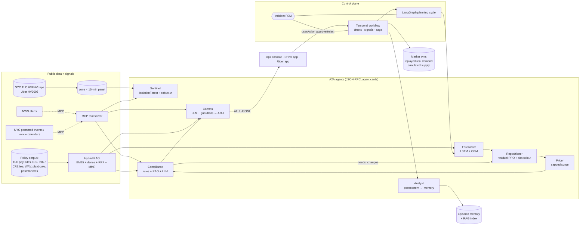
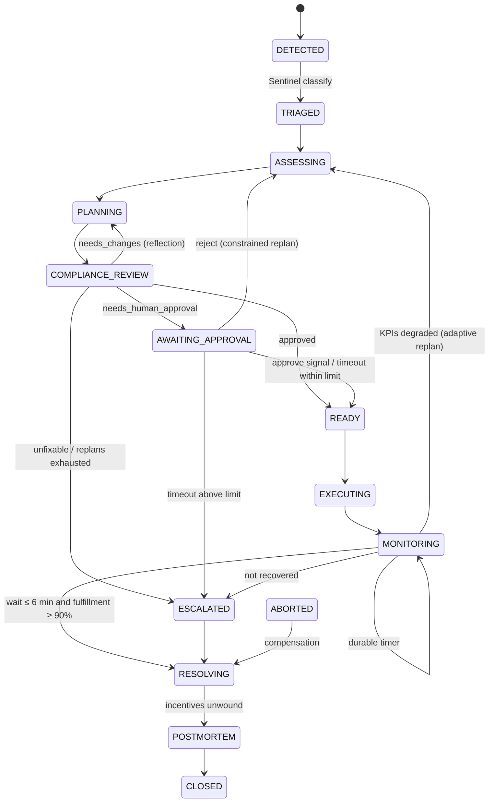
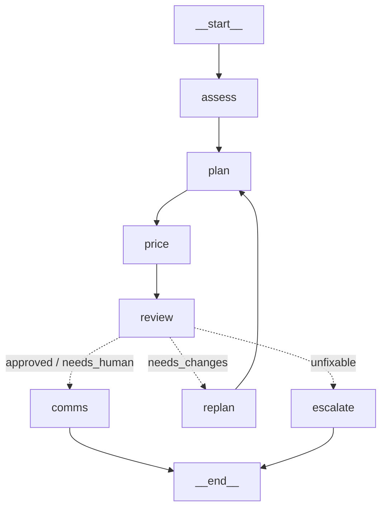

# SurgeShield: architecture and design

## 1. The problem

**Marketplace disruption response for ride-hailing (Uber-style) in NYC.**

A disruption is a sudden local mismatch between rider demand and driver supply. Typical causes are a concert ending at Madison Square Garden, delayed flights arriving in one wave at JFK, a flash-flood warning, or a subway signal failure. It lasts 15–120 minutes. Within minutes:

* rider **wait times jump** (3 → 15+ min) and requests go unfulfilled, so riders churn;
* **surge pricing** spikes. During a declared emergency that creates legal exposure under NY's price-gouging law (GBL 396-r). Since 2014, Uber's agreement with the NY Attorney General caps surge during abnormal market disruptions;
* drivers **sit idle 1–2 km away**, and nobody tells them where to go in time;
* ops teams respond by hand, through dashboards and Slack, usually *after* the peak.

**Why this is the best problem to make agentic:**
* It is **long-running and stateful**: detect, plan, approve, act, monitor and adapt over hours. That needs durable execution and an explicit state machine.
* It needs **every kind of intelligence**: forecasting (DL), wait-time estimation (ML), anomaly detection (ML), sequential decisions under uncertainty (RL), and policy reasoning plus communication (GenAI + RAG).
* It has **real constraints and humans in the loop**: regulations, budgets, accessibility, and approvals above a threshold.
* It has **multiple audiences**: ops, drivers and riders. Each needs a different UI, which is what A2UI is for.
* It is **measurable with public data**. NYC TLC High-Volume FHV trip records include Uber trips (`hvfhs_license_num = HV0003`) with `request_datetime` and `pickup_datetime`, so **real rider wait times** can be computed per zone and per 15 minutes.

## 2. System overview

## 3. Coverage matrix: every agentic concept and where it lives

| Concept | Implementation | File(s) |
|---|---|---|
| **Temporal (durable) execution** | `DisruptionResponseWorkflow`: durable timers between monitoring intervals; `approve` signal; `state` query; per-activity retries and timeouts; idempotent start (workflow id = incident id); saga compensation on cancel/failure | `temporal_app/workflows.py`, `temporal_app/worker.py` |
| **Runtime-agnostic orchestration** | `IncidentOrchestrator`: deterministic control loop written against a 4-method `Runtime` protocol; runs on Temporal or plain asyncio | `orchestration/core.py`, `orchestration/local_runtime.py` |
| **State machine** | 14-state `IncidentFSM` with an explicit transition table. Both LangGraph nodes and the workflow must pass through it, so an illegal step (e.g. PLANNING → EXECUTING without compliance) raises | `orchestration/fsm.py` |
| **Graph-based agent orchestration** | LangGraph `StateGraph` assess → plan → price → review → (replan loop / escalate) → comms, with a checkpointer (thread = incident:cycle) | `orchestration/planning_graph.py` |
| **Multi-agent system** | 7 specialist agents with typed skills | `agents/*.py` |
| **A2A (Agent2Agent)** | Agent cards at `/.well-known/agent-card.json`; JSON-RPC 2.0 `message/send`, `message/stream` (SSE), `tasks/get`, `tasks/cancel`; task lifecycle and transition history; v1.0 method aliases; skill-based registry | `a2a/protocol.py`, `a2a/server.py`, `a2a/client.py` |
| **A2UI (Agent-to-UI)** | v0.8 `surfaceUpdate` / `dataModelUpdate` / `beginRendering`; data binding; component catalog validation; `userAction` events turn into workflow signals; A2UI carried over A2A as DataParts (extension URI in the agent card) | `a2ui/builder.py`, `ui/index.html`, `api/main.py` |
| **MCP (tools)** | MCP server exposing zone snapshots, NWS alerts, NYC events, policy search and TLC minimum pay. Agents call the same tool functions in-process | `mcp_server/server.py`, `mcp_server/tools.py` |
| **LLM** | Provider-agnostic client (Anthropic / OpenAI-compatible / deterministic mock) with pydantic structured outputs, a self-repair loop, and token accounting | `llm/client.py`, `llm/mock.py`, `llm/prompts.py` |
| **RAG** | Heading-aware contextual chunking; BM25 + dense (LSA or sentence-transformers) fused with RRF; metadata filters; MMR; citations; online indexing of new postmortems | `rag/documents.py`, `rag/index.py`, `knowledge/` |
| **Guardrails** | Prompt-injection screening of untrusted feeds; `<untrusted_data>` delimiting; PII redaction; style-guide output checks with auto-repair; the LLM may only tighten a rule-engine verdict | `llm/guardrails.py`, `agents/compliance.py`, `agents/comms.py` |
| **Human-in-the-loop** | Approval card (A2UI) → `/a2ui/action` → Temporal signal; durable timeout policy; rejection with a budget ceiling triggers a constrained replan | `orchestration/core.py::_approval_gate` |
| **Reflection / self-correction** | Compliance `required_changes` feed back into the planner (up to `max_replans`); KPI degradation during monitoring triggers re-assessment | `planning_graph.py::replan`, `core.py::_monitor` |
| **Memory** | Working (graph/workflow state), episodic (SQLite incidents and lessons), semantic (postmortems appended to the RAG index) | `memory/store.py`, `agents/analyst.py` |
| **Deep learning** | Global 2-layer LSTM with zone embeddings, Poisson NLL, multi-horizon direct forecast | `ml/forecaster.py` |
| **Classical ML** | HistGradientBoosting wait-time model; IsolationForest + robust seasonal z-score detector | `ml/wait_model.py`, `ml/anomaly.py` |
| **Reinforcement learning** | Gymnasium env over 20 zones; residual PPO (stable-baselines3) on top of the ops heuristic; evaluated against no-op and greedy baselines | `ml/rl/env.py`, `ml/rl/market_sim.py`, `ml/rl/policy.py` |
| **Digital twin / closed loop** | Incidents replay the *observed* demand while supply responds to the agents' incentives; the same simulator is used for RL training and planning rollouts | `world.py`, `ml/rl/market_sim.py` |
| **Observability** | Nested spans (trace/span/parent ids) for every A2A call, activity and LLM call; counters; `/traces` and `/metrics` | `observability/tracing.py` |
| **Evaluation** | Model metrics, RAG recall@k / MRR, behavioural scenario suite, counterfactual uplift with common random numbers | `eval/harness.py` |

## 4. Agents

| Agent | Skill(s) | Intelligence | Output |
|---|---|---|---|
| **Sentinel** | `detect`, `classify` | robust seasonal z-score + IsolationForest; MCP signals (events, NWS) | `Disruption` (kind, zones, emergency flag, screened context) |
| **Forecaster** | `assess` | LSTM demand forecast with nowcast blending, GBM wait model, episodic and RAG recall of similar incidents | `Assessment` (per-zone forecast, severity) |
| **Repositioner** | `plan` | residual PPO policy → per-zone relocation bonus; model-based rollout gives the expected impact and a budget; obeys compliance feedback | `Plan` + no-action counterfactual |
| **Pricer** | `price` | surge from forecast supply/demand ratio; **emergency cap = max of the 60-day multipliers after dropping the 3 highest** (2014 NY AG agreement) | surge per zone, TLC min-pay check, CRZ fee note |
| **Compliance** | `review` | deterministic rules R1–R8 → RAG per rule → LLM review with citations; the LLM can only make the verdict stricter | `ComplianceReview` |
| **Comms** | `compose` | LLM drafts grounded in style-guide RAG → guardrail checks and repair → **A2UI surfaces** for ops, driver and rider | `CommsBundle` + A2UI messages |
| **Analyst** | `postmortem` | LLM postmortem → episodic memory + RAG index (learning loop) | `Postmortem` |

### Compliance rules (deterministic layer)
| Rule | What it checks | Source in corpus |
|---|---|---|
| R1 surge cap | normal cap 2.5×; during a declared emergency, the 60-day-range cap | GBL 396-r and the 2014 NY AG agreement |
| R2 hard budget | incentive commitment ≤ hard limit | playbook P-2 |
| R3 auto-approve | above the limit → human approval | playbook P-2 / P-5 |
| R4 driver minimum pay | incentives are additive; base pay ≥ TLC per-trip minimum ($1.283/mi + $0.681/min, effective 2026-03-01) | TLC driver pay rates |
| R5 WAV coverage | zones with recent WAV requests need a WAV incentive | TLC WAV obligations, P-4 |
| R6 classification | storm / transit outage without a declared emergency → human confirms | P-1 |
| R7 fair targeting | zone-level incentives only, no individual targeting | P-2 |
| R8 untrusted signals | instruction-like content in feeds → flag and require a human | guardrails |

## 5. Incident lifecycle (state machine)

### LangGraph planning cycle (generated by `GET /graph`)

### How the three layers divide the work
* **Temporal** owns *time and durability*: hours-long loops, timers, waiting for a human, retries, crash recovery, compensation.
* **LangGraph** owns the *reasoning graph* for one planning cycle: which agent runs next, the reflection loop, checkpointed intermediate state.
* **The FSM** is the *contract* both must obey. It is pure Python, so it is replay-safe inside a workflow.

## 6. Data

| Source | Use | Access |
|---|---|---|
| NYC TLC **High Volume FHV trip records** (monthly parquet) | demand, supply proxy (drop-offs), real **wait = pickup − request**, fares, driver pay, WAV flags, `cbd_congestion_fee` (2025+) | `https://d37ci6vzurychx.cloudfront.net/trip-data/fhvhv_tripdata_YYYY-MM.parquet` |
| TLC taxi zone lookup | zone ids and names | `.../misc/taxi_zone_lookup.csv` |
| NWS active alerts | weather emergencies | `api.weather.gov/alerts/active?area=NY` |
| NYC permitted events (Open Data) | event-driven demand | `data.cityofnewyork.us` (Socrata; verify the dataset id) |
| Regulations and policy | RAG corpus (paraphrased with source URLs) | `knowledge/` |

**Synthetic twin.** `data/synthetic.py` emits rows in the *exact HVFHV schema*, with realistic seasonality and **labelled shocks**. CI and the offline demo therefore run without a 450 MB download, and detection can be scored against ground truth. `make data-tlc` switches to the real data with no code changes.

**Known caveat.** TLC records contain *completed* trips only, so observed demand is censored during severe shortages. In production you would use platform request logs. On TLC data, treat `requests` as a lower bound.

## 7. Results (from `make eval`, synthetic twin)

| Component | Result |
|---|---|
| LSTM forecaster | MAE **2.42** requests/15 min vs **3.46** seasonal-naive (−30%) |
| Wait-time GBM | MAE **1.49 min** on disrupted bins vs 2.57 baseline |
| Disruption detector | event recall **100%**, bin precision **74%** |
| RL (200 eval episodes) | residual PPO return **185.4** vs greedy 179.3 vs none 178.2; same fulfillment as greedy (97%) with **~11% less incentive spend** |
| RAG | recall@3 **1.0**, MRR **0.875** on 12 labelled queries |
| Agent scenario suite | **7/7 pass** (FSM legality, valid A2UI, safe messages, citations, emergency cap, HITL, injection defence, unwinding) |
| Counterfactual uplift (same replayed demand, common random numbers) | fulfillment MSG **82% vs 70%**, JFK **83% vs 68%**, poisoned-feed MSG **86% vs 71%**, transit **80% vs 78%**; citywide storm roughly neutral (89% vs 90%) because *every* zone is short, so moving drivers can't create supply. Pricing and new-driver activation are the levers there |

## 8. From reference to production

| Concern | Here | Production |
|---|---|---|
| Event bus / UI stream | in-process `Bus` | Kafka / Redis Streams; A2UI over SSE or WebSocket |
| Vector store | in-memory hybrid index | pgvector / Qdrant / Vertex, same `search()` interface |
| Agent transport | in-process A2A (wire-format exact) or HTTP | one service per agent behind mTLS; agent cards in a registry |
| Market twin | zone-level simulator | platform dispatch simulator; shadow mode before control |
| RL | offline PPO in the simulator | offline RL from logged incentives, then guarded online A/B with budget caps |
| LLM | mock / Claude / OpenAI-compatible | Claude with prompt caching; eval-gated prompt versions (`PROMPT_VERSION`) |
| Approvals | A2UI card | the same card rendered in Slack / Teams / mobile via A2UI renderers |
| Safety | rule engine + guardrails | the above plus red-team suite, audit log retention, policy-as-code (OPA) |

## 9. Limitations (honest)
* Supply is *simulated* (a counterfactual twin), so measured uplifts depend on the simulator's driver-response model.
* The default `mock` LLM is deterministic, so it exercises the plumbing, not language quality. Set `LLM_PROVIDER=anthropic` for real generation.
* Policy summaries in `knowledge/` are paraphrased and dated. Verify them against the linked primary sources before relying on them.
* Approval and budget thresholds are sample values sized for the 20-zone reference twin.
